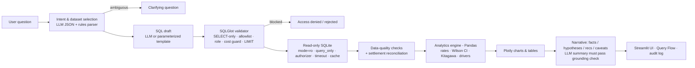

# PayInsight Analytics: AI Business Analyst for Payments

> ⚠️ **All data is synthetic.** It is generated by `data/seed_data.py`. It is **not** real Pine Labs, bank or merchant data, and it contains no PII.

**Live demo:** https://modanwalsarthak0806--payinsight-analytics-ui.us-east.modal.run. It is hosted on Modal and needs no login or API key.

Ask a question about payment performance in plain English, for example *"Why did our success rate fall from Sept to Oct?"*. PayInsight then:

1. works out the datasets, measures, dimensions and time window the question needs;
2. drafts SQL with an LLM (or a deterministic template) and **validates it before execution**;
3. runs it on a **read-only** database;
4. checks data quality, segments the results, and splits the change into **rate effect and mix effect** (Kitagawa);
5. charts the evidence and answers with **facts, hypotheses, recommendations and caveats**, each citing its dataset, filters, time window and n;
6. shows the full trail of steps and every query executed in the **Query Flow** tab.

**Design rule:** the LLM only reads the question and writes words. Every number comes from executed SQL and Python.

---

## Run locally (Windows)
```powershell
cd e:\Pinelabs\payinsight-ai
.\run_app.bat                     # creates .venv + database on first run, then opens http://localhost:8501
```
Or step by step:
```powershell
python -m venv .venv
.\.venv\Scripts\activate
pip install -r requirements.txt
python data/seed_data.py          # builds data/payinsight.db (seed 42) and verifies the scenario targets
streamlit run app.py
pytest tests/                     # 65 tests, always offline (no LLM calls)
```
In VS Code, select the interpreter `payinsight-ai\.venv\Scripts\python.exe`. The global `streamlit` command lacks the project's packages.

## LLM providers
| Provider | Key needed? | Default model | Notes |
|---|---|---|---|
| **OpenRouter** (default) | No: uses the app's key | `nvidia/nemotron-3.5-super-vl:free` | Reasoning enabled. On the shared key the model is locked to the free one; tick "Use my own OpenRouter key" to choose another model. |
| Claude (Anthropic SDK) | Yes: the visitor's own | `claude-haiku-5-5`, effort `low` | Cheapest current Claude; the model is editable in the sidebar. |
| Kimi (Moonshot) | Yes: the visitor's own | `kimi-k3` | OpenAI-compatible API. |
| Offline | No | rules + templates | Always available. |

- Keys typed in the sidebar live only in that browser session's memory; they are never logged, cached or saved.
- Locally, keys can also come from `.env` (see `.env.example`). On Modal they come from the secret `payinsight-secrets`.
- Any provider failure (bad key, 404, 429, timeout, refusal, invalid JSON, empty reasoning output) **falls back to offline mode automatically** and shows a note.
- Guards on every provider: response cache, `LLM_DAILY_CAP` calls per provider per day, and the `LLM_TIMEOUT_S` timeout.

---

## Architecture


| Path | Responsibility |
|---|---|
| `app.py` | Streamlit UI: sidebar, KPI cards, question box, example cards, tabs |
| `ui/components.py`, `ui/styles.css`, `.streamlit/config.toml` | Custom HTML components and theme |
| `analytics/catalog.py` | Semantic layer: tables, columns, measures, dimensions; source of the allowlist and the prompt schema |
| `analytics/nlp.py` | Question → intent: rules parser + LLM planner, ambiguity detection |
| `analytics/sqlgen.py` | Parameterized SQL templates (answer, evidence and trend queries) |
| `analytics/security.py` | SQLGlot validator, role restrictions, cost guard, forced LIMIT |
| `analytics/analysis.py` | Cleaning, rates, Wilson CI, Kitagawa decomposition, drivers, trend |
| `analytics/quality.py` | Data-quality checks; transactions vs settlements reconciliation |
| `analytics/narrator.py` | Deterministic narrative with evidence tags; grounded LLM summary |
| `analytics/pipeline.py` | End-to-end orchestration, step log, query log |
| `analytics/evaluation.py` | 13-question known-answer benchmark (independent SQL ground truth) |
| `utils/llm.py` | OpenRouter / Claude / Kimi / offline providers behind one interface |
| `utils/db.py`, `utils/viz.py`, `utils/audit.py` | Read-only DB access, Plotly charts, JSONL audit trail |
| `data/schema.sql`, `data/seed_data.py` | Table definitions and synthetic data generator |
| `modal_app.py` | Modal deployment ([DEPLOY.md](DEPLOY.md)) |

### UI tour
- **Sidebar:**
  - access role (simulated: Payments Analyst or Merchant Analyst);
  - comparison months;
  - an LLM status card;
  - a **⚙ Change model / use your own API key** panel;
  - the analysis steps for the last question.
- **Main area:** KPI cards, a question box, and 8 example cards in two rows: *Business questions*, and *Failure & control scenarios*.
- **Tabs:**

  | Tab | Contents |
  |---|---|
  | 📊 Answer | Headline, metric strip, charts, top-10 table, findings |
  | 🔎 Drill-down | Kitagawa decomposition by any dimension |
  | 🩺 Data Quality | Checks and cleaning notes |
  | 🛡️ Audit & Evaluation | Benchmark runner, audit trail, data dictionary |
  | 🧭 Query Flow | Every step, the SQL the LLM drafted with the validator's verdict, and every query executed |

### Security layers
1. **Validator** (`security.py`). Rejects:
   - anything that isn't a single SELECT: DDL/DML, PRAGMA, ATTACH, UNION/INTERSECT/EXCEPT, `;`, comments;
   - tables or columns outside the allowlist;
   - dangerous functions;
   - cartesian joins, more than 4 joins, or nesting deeper than 2.

   It also checks that placeholders match the bound parameters, and adds `LIMIT 1000`.
2. **Roles:** `merchant_analyst` cannot read `banks`, `settlements` or `bank_id`.
3. **Read-only connection:** `mode=ro`, `PRAGMA query_only`, a sqlite3 **authorizer** that enforces SELECT-only access and the role's tables at engine level, a timeout, and parameterized execution.
4. **Secrets:** read only from environment variables, `.env` or the session. Never logged, cached or uploaded.

---

## Data dictionary
`transactions` (one row per payment attempt) → `merchants` (m:1) and → `banks` (m:1). `settlements` → `transactions` (m:1) comes from a **separate source system**.

| Table.column | Type | Description |
|---|---|---|
| transactions.transaction_id | TEXT | Intended unique ID (5 duplicates planted) |
| transactions.txn_timestamp | TEXT | `YYYY-MM-DD HH:MM:SS`, May–Oct 2026 (3 NULLs planted) |
| transactions.amount / currency | REAL / TEXT | INR only |
| transactions.merchant_id | TEXT | FK; 10 NULL + 5 orphan `M999` planted |
| transactions.bank_id | TEXT | FK; 20 NULL planted |
| transactions.payment_method | TEXT | UPI, Card, Wallet, NetBanking (1 invalid `Crypto`) |
| transactions.status | TEXT | SUCCESS, FAILED |
| transactions.failure_reason | TEXT | NULL if SUCCESS; Insufficient Funds, Technical Error, Card Expired, Limit Exceeded, Timeout (15 spelling variants, 2 SUCCESS rows with a reason) |
| merchants.* | TEXT | 60 merchants; category Retail, Food, Travel, Utilities, Electronics (`food`, `FOOD`, `Misc` planted); region N/S/E/W |
| banks.* | TEXT | 10 synthetic banks; Domestic or International |
| settlements.* | TEXT/REAL | SETTLED or PENDING; amount net of 1.8% MDR |

**Metrics**
- Success rate = SUCCESS ÷ unique transaction attempts, with duplicate IDs counted once.
- Failure rate = 1 − success rate.
- Confidence: Wilson 95% interval. Segments with fewer than 30 transactions are flagged low confidence; fewer than 10, very low.
- **Kitagawa decomposition** (A = current, B = baseline; for each segment k):
  - w̄ = (wᴬ+wᴮ)/2 and r̄ = (rᴬ+rᴮ)/2;
  - rate effect = Σ w̄·(rᴬ−rᴮ); mix effect = Σ r̄·(wᴬ−wᴮ);
  - rate effect + mix effect = Rᴬ−Rᴮ exactly, verified on every run.

**Built-in scenarios**

| Scenario | Result |
|---|---|
| Sep → Oct decline | 92.80% → 84.95% (−7.85pt). Driver: UPI @ Cobalt Bank, 93.9% → 38.2% (68% of the drop) |
| Jul → Aug decline | 92.85% → 89.86%. 88% mix effect: Utilities share went from 10% to 30% |
| Two sources disagree | In October, settlements are 38 transactions short of gateway successes |

---

## Testing
`pytest tests/` gives **65 passed**:

| File | Tests | Covers |
|---|---|---|
| `test_data.py` | 3 | Scenario targets, defect counts, deterministic seeding |
| `test_security.py` | 23 | 14 malicious-SQL cases, LIMIT capping, parameter mismatch, roles, read-only connection, authorizer |
| `test_analysis.py` | 10 | Hand-computed Kitagawa, pure mix shift, edge cases, confidence intervals, both scenarios, data-quality and reconciliation truth |
| `test_e2e.py` | 8 | Known-answer benchmark (13/13), no invalid SQL, latency, unsafe LLM SQL never executed, hallucinated summary rejected, query log |
| `test_llm.py` | 7 | Claude and OpenRouter providers with stubbed clients; keys never written to disk |
| `test_app.py` | 14 | Headless Streamlit render of every example, the key-entry flow, and no deprecation banners |

## Deployment
See [DEPLOY.md](DEPLOY.md): Modal, a public URL, and scale-to-zero.

## Known limitations
- **Synthetic data in one SQLite file.** `settlements` is labelled as a separate source system. A real deployment would connect to the warehouse with real authentication.
- **Simulated roles.** Roles are chosen from a sidebar dropdown; there is no login.
- **Query cost is rule-based.** The guard checks joins, nesting, LIMIT and a timeout; SQLite has no cost estimator.
- **Offline question understanding is rules-based.** It covers the demo and test phrasings; unusual phrasing works better with an LLM, and ambiguous questions get a clarifying prompt.
- **Free OpenRouter models** have shared daily and per-minute limits. When they hit them, answers fall back to offline mode with correct numbers.
- **Ephemeral logs on Modal.** The audit log and LLM cache reset whenever the container scales to zero.
- **Out of scope:** multiple currencies, real-time data, CI pipeline, fine-tuning.
